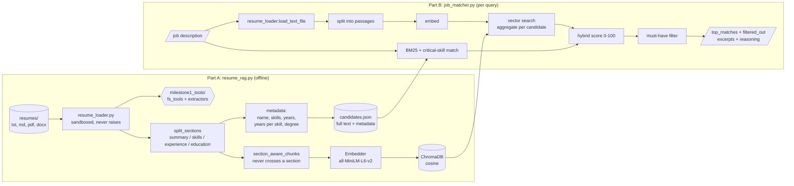

# RAG-Based Resume Matching

A retrieval-augmented system that matches resumes to job descriptions. Part A indexes a
resume corpus into a vector store with section-aware chunking and extracted metadata;
Part B embeds a job description, retrieves candidates, scores them 0-100 with a hybrid of
semantic similarity and exact skill checks, applies hard must-have filters, and returns
each match with the excerpts and reasoning behind it.

No API keys: embeddings run locally with `sentence-transformers/all-MiniLM-L6-v2`. The
sentence-transformers backend does still contact the HuggingFace hub on start-up to
revalidate the cached model, so a query is not network-free by default; set
`HF_HUB_OFFLINE=1` and it makes no network calls at all.

```bash
make setup          # uv venv on Python 3.12 + install
make index          # Part A: build the index from resumes/
make match          # Part B: run the documented queries into outputs/
make test           # 177 tests, 94% line coverage
make notebook       # execute the experiments notebook in place
```

## Deliverables

| Brief asks for | Where it is |
|---|---|
| Part A: RAG system setup | `resume_rag.py` (+ `resume_loader.py`, `milestone1_tools/`) |
| Part B: job matching engine | `job_matcher.py` |
| Dataset: 30+ resumes, 5+ JDs | `resumes/` (43), `job_descriptions/` (7), described in [`DATASET.md`](DATASET.md) |
| Notebook with experimentation and analysis | [`notebooks/experiments.ipynb`](notebooks/experiments.ipynb), committed with outputs |
| Retrieval accuracy metrics | notebook §5, `evaluation/metrics.py`, summarised below |
| Latency metrics | notebook §3 (indexing) and §6 (query) |
| Demo video | [`demo/demo_session.mp4`](demo/demo_session.mp4) - 3:48, a recorded terminal session; [`demo/demo.mp4`](demo/demo.mp4) is the same walkthrough as composed frames. Shot list in [`docs/demo_script.md`](docs/demo_script.md) |
| Resumes loaded via the Milestone 1 tools | `resume_loader.py` over `milestone1_tools/fs_tools.py` ([provenance](milestone1_tools/PROVENANCE.md)) |

Beyond the brief: a graded relevance set with a stated rubric
(`job_descriptions/relevance_labels.json`), ablations that test whether each design
choice earns its place, a separate evaluation of the must-have filter, an error analysis,
a test suite, and a limitations section that says plainly why the headline numbers are an
upper bound.

## Results

Measured over 43 resumes and 7 job descriptions against the graded relevance labels in
`job_descriptions/relevance_labels.json`, MiniLM embeddings, reference date 2026-10-18.
Read the provenance of those labels under [Evaluation](#evaluation) before reading the
numbers - they were not produced by a human annotator. Reproduce with `make notebook`.

**Retrieval accuracy** (macro-averaged across the 7 job descriptions; relevance = graded
label >= 1; `precision@k` divides by k, so its ceiling is below 1 when a JD has fewer
than k relevant candidates):

| P@1 | P@3 | P@5 | R@5 | R@10 | MRR | nDCG@5 | nDCG@10 | MAP |
|---|---|---|---|---|---|---|---|---|
| 1.00 | 1.00 | 0.80 | 0.87 | 0.98 | 1.00 | 0.972 | 0.986 | 0.933 |

**Read the next section before quoting any of these.** On this evaluation set a far simpler
system - exact skill matching plus BM25, with no embeddings and no vector store at all -
scores identically. These figures measure the pipeline end to end; they are not evidence
that the retrieval architecture contributes to the result.

The top-ranked candidate is relevant for every job description. One relevant candidate
out of 33 is missed overall - 32 of 33, or 97%, reach the top 10; the 0.98 in the table is
the macro average of per-JD recall@10, which is a different quantity and is not a
candidate count. The notebook explains which candidate is missed and why.

**Does the retrieval half earn its place? On this evaluation set, no.** Ablating the
scoring components against the same index and labels (notebook §7a):

| Scoring | nDCG@5 | P@1 | P@3 | R@10 | MAP |
|---|---|---|---|---|---|
| Production (.5 semantic / .3 skills / .1 BM25 / .1 experience) | 0.972 | 1.00 | 1.00 | 0.98 | 0.933 |
| **No semantic weight at all (0 / .6 / .2 / .2)** | **0.972** | **1.00** | **1.00** | **0.98** | **0.933** |
| No semantic weight (0 / .5 / .3 / .2) | 0.972 | 1.00 | 1.00 | 0.98 | 0.935 |
| BM25 only | 0.967 | 1.00 | 0.90 | 0.98 | 0.927 |
| Critical-skill coverage only | 0.958 | 1.00 | 0.95 | 0.96 | 0.917 |
| Semantic similarity only | 0.862 | 0.86 | 0.90 | 0.87 | 0.864 |
| Experience fit only | 0.145 | 0.14 | 0.14 | 0.26 | 0.183 |

A blend with **zero** semantic weight ties production on every metric. Deleting the
embeddings and the vector store - the whole of Part A's reason for existing - would cost
nothing measurable here. An earlier version of this README claimed "the hybrid score earns
its complexity" on the strength of beating semantic-only; that was the wrong comparison,
and the grid it came from contained no zero-semantic configuration, so the claim had never
been tested. It is withdrawn.

**Why, and the experiment that isolates it.** These seven job descriptions name the
required skills in the same words the resumes use - "PyTorch", "Kafka", "React" - because
both sides were written for this assignment. Exact matching therefore has nothing left for
embeddings to add. Real job descriptions are written by people who do not know which words
a candidate chose, which is the condition dense retrieval exists for.

Notebook §7d restates all seven roles with **no literal skill token** - a constraint
checked mechanically, by asserting `extract_skills()` finds nothing in them - and holds the
relevance labels fixed, since the roles are unchanged:

| | literal JDs | paraphrased JDs |
|---|---|---|
| Production | 0.972 | 0.922 |
| No semantic weight | 0.972 | 0.831 |
| Semantic only | 0.862 | 0.911 |
| **what the dense half adds** | **+0.000** | **+0.091 nDCG@5, +0.143 MAP** |

So the architecture is not dead weight - it has a precondition, and that precondition is a
query that does not quote the corpus. The shipped evaluation set does not meet it, so on
the shipped set the design is unjustified by its own numbers. The honest conclusion is
about the dataset: **job descriptions written independently of the resumes are the single
change that would most improve this evaluation**, and nothing else on the "what I would do
next" list comes close.

Caveat on §7d: I wrote the paraphrases, so I authored both the query and the system under
test. The no-literal-token constraint bounds how much that can bias the result but does not
remove it, and the paraphrases are deliberately harder than a typical posting, so +0.091 is
an upper bound rather than a typical case.

**Must-have filtering** removed no labelled-relevant candidate for any of the 7 job
descriptions (recall after filtering 1.00). A skill-scoped requirement filters usefully
("3+ years React" cuts 43 candidates to 6 and lifts precision from ~0.09 to 0.67); a bare
"N+ years experience" requirement keeps between 34 and 42 of 43 and barely filters at
all.

**Latency.** Measured on an M-series laptop, CPU only, 43 resumes / 179 chunks. These are
machine-specific: reproduce them with `make notebook` rather than expecting these exact
figures elsewhere. Every phase is timed directly - nothing is derived by subtracting one
timed run from another - and both the indexing and query cells assert that the phases
account for essentially all of the wall clock, so an unattributed remainder cannot hide.

| Index build (notebook §3) | |
|---|---|
| Total | 13.4 s |
| of which loading MiniLM, once per process | 12.1 s (90%) |
| everything else | 1.28 s = 30 ms per resume, 7 ms per chunk |
| breakdown: open ChromaDB / embed / store / read+parse | 0.63 s / 0.42 s / 0.15 s / 0.06 s |
| unattributed | 0.008 s (0.1%) |

| Query (notebook §6) | |
|---|---|
| Median end to end | 7.4 ms |
| Worst p95 across the 7 JDs | 10.4 ms |
| Embedding the JD | 65.2% |
| Vector search | 18.7% |
| Scoring and explanation | 8.2% |
| BM25 | 2.9% |
| Parsing the JD | 2.7% |

Indexing is model-load bound rather than data bound, so a long-lived process should hold
one `Embedder` instead of constructing one per request. A query is dominated by embedding
the job description, so the useful optimisation is to embed fewer passages or cache the JD
embedding - not to tune the vector store.

**Profiling by phase paid for itself, after the profile itself was fixed.** The first
breakdown attributed 66% of query time to scoring, which is impossible for a few
arithmetic operations per candidate - and it was an artefact of the method: phases were
derived by subtracting separately timed runs from the end-to-end time, which produced
negative durations for whole phases. With direct instrumentation in place, the real defect
showed up: `extract_skills(jd)` was being called inside the per-candidate loop, sweeping
73 compiled patterns over the job description once per candidate, 43 times per query.
Notebook §6 now measures the fix as a live A/B by reinstating exactly that work: it costs
**21.2 ms at p50, a 3.3x difference**. A regression test asserts the JD is scanned once
rather than once per candidate. The end-to-end number looked perfectly acceptable at ~30
ms; only a *sound* breakdown found it.

## Architecture



## Repository layout

```
resume_rag.py                     Part A: load, chunk, extract metadata, embed, store
job_matcher.py                    Part B: retrieve, score, filter, explain
resume_loader.py                  the only adapter over the Milestone 1 file tools
milestone1_tools/                 verbatim fs_tools.py + extractors.py + PROVENANCE.md
evaluation/metrics.py             precision@k, recall@k, MRR, MAP, nDCG@k
evaluation/harness.py             label loading and validation, latency, filter scoring
evaluation/paraphrased_jds/       the same 7 roles restated with no literal skill tokens,
                                  used by notebook 7d to isolate dense retrieval
notebooks/experiments.ipynb       experiments, metrics, ablations, error analysis
resumes/                          43 resumes in 4 formats
job_descriptions/                 7 JDs + relevance_labels.json (rubric inline)
outputs/                          example matcher output
tests/                            177 tests
DATASET.md                        dataset card: provenance, coverage, edge cases
docs/demo_script.md               demo video shot list
docs/independent_evaluation_set.md  protocol for an independently written JD set
scripts/make_demo_video.py        renders demo/demo.mp4 from live output + notebook charts
demo/demo_session.mp4             the 3:48 demo, recorded as a terminal session
demo/demo.mp4                     the same walkthrough as composed frames
scripts/record_terminal_session.py  records the session and renders it
Makefile                          make setup / index / match / test / notebook
```

## The demo video

[`demo/demo.mp4`](demo/demo.mp4) is a 3 minute 48 second captioned walkthrough: the
pipeline running, the matcher's output and reasoning, the rejected candidates with their
reasons, the test suite, and the four charts from the notebook, including the ablation
showing the retrieval half adds nothing on this evaluation set.

It is **composed rather than screen-captured** - `scripts/make_demo_video.py` runs the real
commands, reads the executed notebook's own chart images, lays the output out as frames and
encodes them with ffmpeg. No frame contains hand-typed results, so the video cannot drift
from the code the way a recorded take can, and `make video` regenerates it after any
change. There is no voice track; every frame carries its own caption.

[`demo/demo_session.mp4`](demo/demo_session.mp4) is the same walkthrough recorded as a
**terminal session** rather than composed: `scripts/record_terminal_session.py` runs the
demo under a pseudo-terminal, timestamps every chunk of output as it arrives, then replays
it through a terminal emulator and draws it at 10 fps. Output therefore appears
progressively at the speed it actually ran - results filling in line by line, and the index
build visibly taking its twelve seconds. It needs no screen-recording permission and
captures nothing but the session itself. This is the one to watch first.

If a literal screen capture is wanted instead, `make screencast` produces one:
`./demo_drive.sh auto` runs the same beats at a readable pace while `screencapture` records
the display, and the notebook's chart cards are appended. It needs macOS Screen Recording
permission for your terminal (the script checks, and says how to grant it), and it records
the whole display, so close anything private and turn on Do Not Disturb first.

## Setup

Python 3.12 with [uv](https://docs.astral.sh/uv/). 3.12 rather than 3.14 because
`sentence-transformers` pulls in PyTorch and 3.14 wheels are not verified here.

```bash
uv venv --python 3.12 .venv
VIRTUAL_ENV=.venv uv pip install -r requirements-dev.txt   # or requirements.txt to just run it
```

`requirements.txt` keeps `>=` ranges so the project installs on other platforms.
`requirements-lock.txt` pins every version of the environment the reported numbers were
measured in (macOS arm64, CPython 3.12.14) - install that one to reproduce the
measurements exactly rather than approximately.

The install is around 1 GB on macOS arm64, almost all of it PyTorch; on Linux with CUDA
wheels the same environment is several times larger (one measured Linux install came to
6.1 GB). If `sentence-transformers` is absent, `Embedder` falls back to ChromaDB's ONNX
export of the same MiniLM model, so `pip install chromadb rank-bm25 pypdf python-docx` is
enough to run everything - a test covers that fallback. Note that ChromaDB downloads that
ONNX model on first use rather than shipping it, so the light install is not offline on
its first run.

## Run

```bash
# Part A: build the vector store. --as-of pins the reference date for open-ended
# roles ("Jan 2021 - Present"), so experience years and every metric stay reproducible.
python resume_rag.py --resumes resumes --db chroma_db --reset --as-of 2026-10-18

# Part B: match a job description
python job_matcher.py --jd-file job_descriptions/senior_ml_engineer.txt \
    --k 10 --output outputs/senior_ml_engineer.json

# State a requirement the JD leaves implicit, and print only the assignment's schema
python job_matcher.py --jd-file job_descriptions/backend_engineer.txt \
    --must-have "5+ years Java" --brief
```

## How it works

### Part A: `resume_rag.py`

1. **Loading** goes through `resume_loader.py`, a thin adapter over the Milestone 1
   `fs_tools`. That brings the sandboxing (paths confined to the resume directory; `..`,
   absolute escapes, symlinks and hidden files refused), content-sniffing format
   detection, DOCX tables/headers/footers, PDF text extraction, and the never-raise
   contract where failures come back as data. An unreadable or empty resume is reported
   as a skip and recorded in the registry, not dropped silently. `list_files` is not
   recursive, so the resume directory must be flat.
2. **Section-aware chunking.** Headings such as *Summary, Skills, Experience, Education,
   Projects* and synonyms ("Work History", "Profile", "Key Skills") are detected. Each
   section becomes its own chunk; long sections are split on blank lines (one block per
   role) and packed to ~900 characters. A chunk never crosses a section boundary, and
   each embedded chunk is prefixed with its section label so "Education: ..." and
   "Experience: ..." stay distinct to the model. The contact header is not embedded; a
   resume with no recognisable headings at all is embedded whole as one section rather
   than being indexed with zero chunks. The strategy is an injectable seam
   (`section_aware_chunks`), which is how the notebook ablates it against a fixed window
   and whole-document baselines.
3. **Metadata extraction.**
   - *Name*: a `Name:` field, else the first short header line; ALL-CAPS names are
     normalised, mixed-case names left alone.
   - *Skills*: matched against 73 canonical skills with aliases (`k8s` to Kubernetes,
     `sklearn` to scikit-learn). Word-boundary aware, so "Swiftcart" is not Swift and
     "JavaScript" is not Java. Interests, hobbies and references sections are chunked and
     retrievable but excluded from skill extraction, because a hobby is not a competency.
   - *Experience years*: date ranges in Experience (`Jan 2019 - Present`, `2016 – 2019`,
     `03/2020 - 06/2022`) merged so overlapping roles are not double counted and career
     gaps are not bridged. An explicit "8+ years of experience" claim can raise the
     figure but never lower it.
   - *Years per skill*: a role's duration is attributed to the skills named inside that
     role, where a role spans title line to title line, and frameworks count towards
     their language (PyTorch towards Python). This is what makes "5+ years Python"
     answerable rather than guessable.
   - *Education*: highest degree level (PhD > Master > Bachelor > Associate) plus the line.
4. **Storage.** Chunks, embeddings and flat metadata go into a persistent ChromaDB
   collection in cosine space, so `where={"experience_years": {"$gte": 5}}` works. A
   `candidates.json` registry holds full text and structured metadata for BM25 and
   requirement checks, plus how the index was built (model, backend, chunker, reference
   date, per-phase timings, skips). Re-indexing is idempotent. Candidates are keyed by a
   hash of the resume path, never by name - the corpus contains two pairs of different
   people who share a name.

### Part B: `job_matcher.py`

1. **Semantic search.** The JD is split into passages (MiniLM truncates long inputs),
   each is embedded and queried, and chunk hits are aggregated per candidate (best
   similarity plus top-3 mean).
2. **Keyword search.** BM25 over full resume text, plus exact matching of *critical
   skills*: those named in the JD's Requirements/Must-have section, or in sentences
   containing "must"/"required". Falls back to every skill in the JD when it has no
   headings.
3. **Score (0-100)** = 50% semantic + 30% critical-skill coverage + 10% BM25 + 10%
   experience fit, with the per-component breakdown in the output. Weights are an
   injectable, validated `ScoreWeights` object, which is how the notebook ablates them.
   Equal scores tie-break on resume path, so ranking is reproducible.
4. **Must-have filtering.** "N+ years X" statements are read from the JD automatically
   and more can be added with `--must-have` (`"5+ years Python"`, `"Kubernetes"`,
   `"Master's degree"`). Failing candidates are excluded from `top_matches` and listed in
   `filtered_out` **with the reason**, so a rejection is always visible and contestable.
   A `--must-have` that cannot be parsed is reported loudly rather than ignored, since a
   silently dropped filter is worse than a rejected one.
5. **Reasoning** opens with the score, then names matched and missing critical skills,
   the sections closest to the JD with their similarity, experience against the
   requirement, education, and which must-haves were met. It deliberately states **no
   verdict**: earlier versions opened with "Strong match" / "Good match" on score
   thresholds that were never calibrated against the relevance labels, and on this
   evaluation set 37 of the 268 candidate/JD pairs a human would call irrelevant were
   described that way - including two DevOps engineers with no ML background for the ML
   role. The score ranks candidates against one job description; it does not grade them. `relevant_excerpts` are the top-matching chunks, tagged by
   section - the retrieved evidence, not a summary of it.

### Output

The assignment's fields (`job_description`, and per match `candidate_name`,
`resume_path`, `match_score`, `matched_skills`, `relevant_excerpts`, `reasoning`) are
always present. The default output adds `critical_skills`, `must_have_requirements`,
`unparsed_must_haves`, `score_weights`, `filtered_out`, `matched_sections`,
`score_breakdown`, `experience_years` and `education`. `--brief` prints exactly the
assignment's schema and nothing else.

## Evaluation

`job_descriptions/relevance_labels.json` grades candidates per JD as 2 ("would
shortlist"), 1 ("plausible") or unlisted (0), with the rubric stated in the file and
per-JD *hard negatives* - candidates built to be traps - for error analysis.

**Who labelled these, and what that costs.** The labels were written by a Claude session
working from the resume and job-description text against the rubric in the file - a
single AI annotator, not a human one, and not independently reviewed. This is the biggest
limitation on every accuracy number in this repository, because the corpus, the labels
and the system all originate from the same project. Treat the figures as an internal
consistency check, not as external validation.

What I can and cannot support about their independence:

- *Verified*: the label file was committed once and never edited afterwards, so the labels
  were not retuned to flatter a result.
- *Not supported*: that the labels predate every matcher run. Sample matcher output for
  two of the seven job descriptions was already in the repository before the label file
  existed, so for those two I cannot rule out that seeing output influenced the labelling.
  An earlier version of this README claimed the labels were "fixed before any matcher run"
  and that claim was not checkable; it has been withdrawn.

Two measurements are kept deliberately apart:

- **Retrieval quality** is scored on the full unfiltered ranking (`apply_filters=False`),
  so ranking quality is not conflated with hard filtering.
- **The must-have filter** is scored separately as a classification, where the expensive
  error is a *false reject*: a relevant candidate removed because a date-derived years
  estimate disagreed with a human's reading.

Label loading rejects anything that would silently corrupt a metric: a missing JD, a
`resume_path` that does not exist, a duplicate label, a grade outside {1, 2}, or a JD
with no relevant candidate (which makes recall undefined).

## Testing

```bash
make test        # 177 tests, ~8s, 94% line coverage
make test-all    # also the 3 tests that load the real MiniLM model
```

Integration tests use a deterministic hashed bag-of-words embedder: lexical overlap still
produces real cosine similarity, so a test can assert which candidate wins without paying
12 seconds of model loading. Every experience assertion is pinned to a reference date so
no test rots. Covered among others: the sandbox refuses `../secret.txt` and absolute
paths outside the resume directory; DOCX table cells and document headers are read; a
corrupt `.docx` is skipped without aborting the batch; two people sharing a name get
distinct ids; a resume with no headings is still retrievable.

## Design decisions and trade-offs

- **Section-aware chunking over a fixed window.** Measured both ways in notebook §7b, and
  the honest result is narrower than the intuition: on the shipped job descriptions
  whole-document chunking scores within 0.003 nDCG@5 of section-aware, so the choice is
  **not** justified by those numbers. It is worth about 0.05 nDCG@5 once the query is
  paraphrased (§7d), and it costs nothing either way. The remaining argument for it is
  one the metrics cannot score: an excerpt tagged `[Experience]` is easier to justify to a
  recruiter than a window that starts mid-sentence.
- **Hybrid scoring over pure vector search.** The single clearest experimental result
  here: embeddings cannot tell "ML platform engineer" from "ML engineer", and an exact
  skill check can.
- **Must-haves as a hard filter, not a score penalty.** "5+ years Python" is a yes/no
  question a recruiter has already decided; burying it in a weighted sum would let a
  strong-but-unqualified candidate outrank a qualified one. The cost is that a wrong
  years estimate rejects someone, which is why `filtered_out` always carries its reason.
- **Vendored Milestone 1 tools rather than a path dependency.** The assignment ships as
  one self-contained repository; hashes in `PROVENANCE.md` are re-checked at index time
  so drift is reported rather than silent - though note this is a warning, not an
  enforcement: the expected hashes are hard-coded in `resume_loader.py` and a mismatch
  prints to stderr without failing the build. It also cannot prove the copies are genuine
  on its own, since the files and the hashes live in the same repository; the independent
  check is to hash them against the public Milestone 1 repository at commit `fc7cf0c`.
  `MILESTONE1_TOOLS_DIR` points at a live checkout when wanted.
- **A pinned reference date.** Experience derived from "Present" grows with the calendar,
  so without `--as-of` every reported metric would drift. One candidate in this corpus
  crosses a 5-year Python threshold in December 2027 purely by the passage of time.
- **Extractive reasoning rather than generated prose.** `relevant_excerpts` are the
  retrieved chunks themselves and `reasoning` is assembled from measured facts, so every
  statement in the output is traceable to a specific chunk and a specific extracted
  number. **This buys traceability, not correctness, and an earlier version of this README
  overclaimed by saying such reasoning "could not hallucinate a qualification".** It can,
  because the extracted number can itself be wrong: the product manager in
  `resumes/resume_aisha_bello.docx` was credited with 5.8 years of Java on the strength of
  one sentence, "Partnered with the Java backend team". She passed
  `--must-have "5+ years Java"`, appeared in `top_matches`, and the reasoning stated
  "Must-haves met: 5+ years Java (5.8 yrs Java)" - a qualification she does not have,
  asserted in the output. Per-skill years now require corroboration (the skill declared in
  Skills or Summary, or used in more than one role), so she is now filtered out with 0 years
  of Java - but the general point stands, because any extracted number can be wrong. What
  extractive reasoning does guarantee is that the claim is auditable: the sentence it came
  from is in the index and the per-skill figure is in the registry, so the error is findable.
  A generated paragraph would have produced the same false claim with nothing to trace it to.
- **A marginally better weighting was found and not adopted.** `.6` semantic / `.4`
  skills edges the production weights on nDCG@5. With 7 queries that is one or two rank
  swaps and there is no held-out split, so adopting it would mean reporting an accuracy
  tuned on the labels used to measure it. It is recorded as a hypothesis instead.

## Limitations and responsible use

The headline numbers are an upper bound, and it matters to say why: 43 synthetic resumes
written for this assignment and labelled by the same project, 4-7 relevant candidates per
JD, 7 queries, and no held-out split. Skill extraction is a fixed vocabulary, so a skill
outside it is invisible. Experience years are inferred from date ranges, which resumes
with vague dates, gaps or overlapping contracts will defeat.

The first of those is the one that matters most, and it has a written fix:
[`docs/independent_evaluation_set.md`](docs/independent_evaluation_set.md) is a protocol
for building a second evaluation set whose job descriptions are written without reading the
resumes, including the blind-authoring rule, the labelling sequence that keeps the queries
frozen, and the vocabulary-overlap measurement that decides whether it worked.

Matching is not hiring. The score ranks text similarity and declared skills; it does not
measure capability. Candidate names are deliberately excluded from the embedded text so
names cannot influence ranking, but the resume body still carries signals (schools,
employers, phrasing) that correlate with demographics. Any real use needs an
adverse-impact audit, a human decision-maker, and `filtered_out` surfaced rather than
hidden so rejections can be contested. Notebook §10 states this in full, along with what
I would do next.

## Swapping components

- **Embedding model**: `--model` on `resume_rag.py`. `BAAI/bge-small-en-v1.5` was compared
  in notebook §7c and is level on nDCG@5 (0.972) with marginally better MAP (0.935 against
  0.933) for a larger download; MiniLM remains the default. Note the comparison is
  confounded: `SIM_FLOOR`/`SIM_CEIL` in `job_matcher.py` are hand-set for MiniLM's
  similarity distribution, so another model is scored through a band calibrated for this
  one. The
  matcher reads the model from the registry and warns if you query with a different one,
  since similarities are not comparable across models.
- **Chunking strategy**: pass any `chunker` to `build_index` - see
  `section_aware_chunks` and the baselines in notebook §7b.
- **Scoring weights**: pass a `ScoreWeights` to `match()`; it validates that weights sum
  to 1.
- **OpenAI/Cohere embeddings**: replace `Embedder.embed()`; nothing else changes.
- **Pinecone/Weaviate**: replace `get_collection()` and the `collection.query` call in
  `JobMatcher.semantic_search()`.
