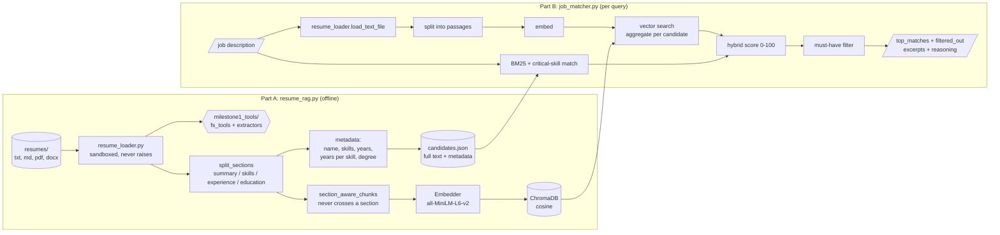

# RAG-Based Resume Matching

A retrieval-augmented system that matches resumes to job descriptions. Part A indexes a
resume corpus into a vector store with section-aware chunking and extracted metadata;
Part B embeds a job description, retrieves candidates, scores them 0-100 with a hybrid of
semantic similarity and exact skill checks, applies hard must-have filters, and returns
each match with the excerpts and reasoning behind it.

No API keys and no network calls at query time: embeddings run locally with
`sentence-transformers/all-MiniLM-L6-v2`.

```bash
make setup          # uv venv on Python 3.12 + install
make index          # Part A: build the index from resumes/
make match          # Part B: run the documented queries into outputs/
make test           # 154 tests, 95% line coverage
make notebook       # execute the experiments notebook in place
```

## Deliverables

| Brief asks for | Where it is |
|---|---|
| Part A: RAG system setup | `resume_rag.py` (+ `resume_loader.py`, `milestone1_tools/`) |
| Part B: job matching engine | `job_matcher.py` |
| Dataset: 30+ resumes, 5+ JDs | `resumes/` (43), `job_descriptions/` (7), described in [`DATASET.md`](DATASET.md) |
| Notebook with experimentation and analysis | [`notebooks/experiments.ipynb`](notebooks/experiments.ipynb), committed with outputs |
| Retrieval accuracy metrics | notebook §5, `evaluation/metrics.py`, summarised below |
| Latency metrics | notebook §3 (indexing) and §6 (query) |
| Demo video | script and shot list in [`docs/demo_script.md`](docs/demo_script.md) |
| Resumes loaded via the Milestone 1 tools | `resume_loader.py` over `milestone1_tools/fs_tools.py` ([provenance](milestone1_tools/PROVENANCE.md)) |

Beyond the brief: a hand-labelled relevance set with a stated rubric
(`job_descriptions/relevance_labels.json`), ablations that test whether each design
choice earns its place, a separate evaluation of the must-have filter, an error analysis,
a test suite, and a limitations section that says plainly why the headline numbers are an
upper bound.

## Results

Measured over 43 resumes and 7 job descriptions with hand-labelled relevance, MiniLM
embeddings, reference date 2026-10-18. Reproduce with `make notebook`.

**Retrieval accuracy** (macro-averaged across the 7 job descriptions; relevance = graded
label >= 1; `precision@k` divides by k, so its ceiling is below 1 when a JD has fewer
than k relevant candidates):

| P@1 | P@3 | P@5 | R@5 | R@10 | MRR | nDCG@5 | nDCG@10 | MAP |
|---|---|---|---|---|---|---|---|---|
| 1.00 | 0.95 | 0.80 | 0.87 | 0.98 | 1.00 | 0.968 | 0.982 | 0.93 |

The top-ranked candidate is relevant for every job description, and 98% of relevant
candidates reach the top 10. One relevant candidate out of 33 is missed overall; the
notebook explains which and why.

**The hybrid score earns its complexity.** Ablating the components against the same
index and labels:

| Scoring | nDCG@5 | P@1 | R@10 |
|---|---|---|---|
| **Hybrid (production: .5 semantic / .3 skills / .1 BM25 / .1 experience)** | **0.968** | **1.00** | **0.98** |
| Semantic similarity only | 0.860 | 0.86 | 0.87 |
| Critical-skill coverage only | 0.958 | 1.00 | 0.96 |
| BM25 only | 0.967 | 1.00 | 0.96 |
| Experience fit only | 0.145 | 0.14 | 0.26 |

Dense retrieval alone puts an irrelevant candidate first for one job description in
seven: MiniLM rates "ML *platform* engineer" as very close to "ML engineer", and only an
exact check against the JD's required skills separates them. BM25 alone scores well
because this corpus shares literal skill tokens between resumes and JDs - a property of
the dataset, not a general result, and the notebook says so.

**Must-have filtering** removed no labelled-relevant candidate for any of the 7 job
descriptions (recall after filtering 1.00). A skill-scoped requirement filters usefully
("3+ years React" cuts 43 candidates to 6 and lifts precision from ~0.09 to 0.67); a bare
"N+ years experience" requirement keeps 38-42 of 43 and barely filters at all.

**Latency** (M-series laptop, CPU only, 43 resumes / 179 chunks):

| | |
|---|---|
| Index build, total | 14.1 s |
| of which loading MiniLM once | 12.3 s |
| actual load + parse + embed + store | 1.25 s (29 ms per resume, 7 ms per chunk) |
| Query, end to end | 8 ms median, 11 ms worst p95 |
| of which embedding the JD | 53% |
| vector search / BM25 / scoring | 38% / 2% / 7% |

Indexing is model-load bound, not data bound, so a long-lived process should hold one
`Embedder` rather than constructing one per request.

Profiling the query *by phase* paid for itself: the first run showed the residual scoring
phase at 66% of latency, which is impossible for a few arithmetic operations per
candidate. The cause was `extract_skills(jd)` being called inside the per-candidate loop,
re-running ~80 regex patterns over the job description 43 times per query. Hoisting it cut
the median query from 22 ms to 8 ms, and a regression test now asserts the JD is scanned
once rather than once per candidate. The end-to-end number alone looked fine; the breakdown is what found it.

## Architecture



## Repository layout

```
resume_rag.py                     Part A: load, chunk, extract metadata, embed, store
job_matcher.py                    Part B: retrieve, score, filter, explain
resume_loader.py                  the only adapter over the Milestone 1 file tools
milestone1_tools/                 verbatim fs_tools.py + extractors.py + PROVENANCE.md
evaluation/metrics.py             precision@k, recall@k, MRR, MAP, nDCG@k
evaluation/harness.py             label loading and validation, latency, filter scoring
notebooks/experiments.ipynb       experiments, metrics, ablations, error analysis
resumes/                          43 resumes in 4 formats
job_descriptions/                 7 JDs + relevance_labels.json (rubric inline)
outputs/                          example matcher output
tests/                            154 tests
DATASET.md                        dataset card: provenance, coverage, edge cases
docs/demo_script.md               demo video shot list
Makefile                          make setup / index / match / test / notebook
```

## Setup

Python 3.12 with [uv](https://docs.astral.sh/uv/). 3.12 rather than 3.14 because
`sentence-transformers` pulls in PyTorch and 3.14 wheels are not verified here.

```bash
uv venv --python 3.12 .venv
VIRTUAL_ENV=.venv uv pip install -r requirements-dev.txt   # or requirements.txt to just run it
```

The install is around 1 GB, almost all of it PyTorch. If `sentence-transformers` is
absent, `Embedder` falls back to ChromaDB's bundled ONNX export of the same MiniLM model,
so `pip install chromadb rank-bm25 pypdf python-docx` is enough to run everything - a
test covers that fallback.

## Run

```bash
# Part A: build the vector store. --as-of pins the reference date for open-ended
# roles ("Jan 2021 - Present"), so experience years and every metric stay reproducible.
python resume_rag.py --resumes resumes --db chroma_db --reset --as-of 2026-10-18

# Part B: match a job description
python job_matcher.py --jd-file job_descriptions/senior_ml_engineer.txt \
    --k 10 --output outputs/senior_ml_engineer.json

# State a requirement the JD leaves implicit, and print only the assignment's schema
python job_matcher.py --jd-file job_descriptions/backend_engineer.txt \
    --must-have "5+ years Java" --brief
```

## How it works

### Part A: `resume_rag.py`

1. **Loading** goes through `resume_loader.py`, a thin adapter over the Milestone 1
   `fs_tools`. That brings the sandboxing (paths confined to the resume directory; `..`,
   absolute escapes, symlinks and hidden files refused), content-sniffing format
   detection, DOCX tables/headers/footers, PDF text extraction, and the never-raise
   contract where failures come back as data. An unreadable or empty resume is reported
   as a skip and recorded in the registry, not dropped silently. `list_files` is not
   recursive, so the resume directory must be flat.
2. **Section-aware chunking.** Headings such as *Summary, Skills, Experience, Education,
   Projects* and synonyms ("Work History", "Profile", "Key Skills") are detected. Each
   section becomes its own chunk; long sections are split on blank lines (one block per
   role) and packed to ~900 characters. A chunk never crosses a section boundary, and
   each embedded chunk is prefixed with its section label so "Education: ..." and
   "Experience: ..." stay distinct to the model. The contact header is not embedded; a
   resume with no recognisable headings at all is embedded whole as one section rather
   than being indexed with zero chunks. The strategy is an injectable seam
   (`section_aware_chunks`), which is how the notebook ablates it against a fixed window
   and whole-document baselines.
3. **Metadata extraction.**
   - *Name*: a `Name:` field, else the first short header line; ALL-CAPS names are
     normalised, mixed-case names left alone.
   - *Skills*: matched against ~80 canonical skills with aliases (`k8s` to Kubernetes,
     `sklearn` to scikit-learn). Word-boundary aware, so "Swiftcart" is not Swift and
     "JavaScript" is not Java. Interests, hobbies and references sections are chunked and
     retrievable but excluded from skill extraction, because a hobby is not a competency.
   - *Experience years*: date ranges in Experience (`Jan 2019 - Present`, `2016 – 2019`,
     `03/2020 - 06/2022`) merged so overlapping roles are not double counted and career
     gaps are not bridged. An explicit "8+ years of experience" claim can raise the
     figure but never lower it.
   - *Years per skill*: a role's duration is attributed to the skills named inside that
     role, where a role spans title line to title line, and frameworks count towards
     their language (PyTorch towards Python). This is what makes "5+ years Python"
     answerable rather than guessable.
   - *Education*: highest degree level (PhD > Master > Bachelor > Associate) plus the line.
4. **Storage.** Chunks, embeddings and flat metadata go into a persistent ChromaDB
   collection in cosine space, so `where={"experience_years": {"$gte": 5}}` works. A
   `candidates.json` registry holds full text and structured metadata for BM25 and
   requirement checks, plus how the index was built (model, backend, chunker, reference
   date, per-phase timings, skips). Re-indexing is idempotent. Candidates are keyed by a
   hash of the resume path, never by name - the corpus contains two pairs of different
   people who share a name.

### Part B: `job_matcher.py`

1. **Semantic search.** The JD is split into passages (MiniLM truncates long inputs),
   each is embedded and queried, and chunk hits are aggregated per candidate (best
   similarity plus top-3 mean).
2. **Keyword search.** BM25 over full resume text, plus exact matching of *critical
   skills*: those named in the JD's Requirements/Must-have section, or in sentences
   containing "must"/"required". Falls back to every skill in the JD when it has no
   headings.
3. **Score (0-100)** = 50% semantic + 30% critical-skill coverage + 10% BM25 + 10%
   experience fit, with the per-component breakdown in the output. Weights are an
   injectable, validated `ScoreWeights` object, which is how the notebook ablates them.
   Equal scores tie-break on resume path, so ranking is reproducible.
4. **Must-have filtering.** "N+ years X" statements are read from the JD automatically
   and more can be added with `--must-have` (`"5+ years Python"`, `"Kubernetes"`,
   `"Master's degree"`). Failing candidates are excluded from `top_matches` and listed in
   `filtered_out` **with the reason**, so a rejection is always visible and contestable.
   A `--must-have` that cannot be parsed is reported loudly rather than ignored, since a
   silently dropped filter is worse than a rejected one.
5. **Reasoning** names matched and missing critical skills, the sections closest to the
   JD with their similarity, experience against the requirement, education, and which
   must-haves were met. `relevant_excerpts` are the top-matching chunks, tagged by
   section - the retrieved evidence, not a summary of it.

### Output

The assignment's fields (`job_description`, and per match `candidate_name`,
`resume_path`, `match_score`, `matched_skills`, `relevant_excerpts`, `reasoning`) are
always present. The default output adds `critical_skills`, `must_have_requirements`,
`unparsed_must_haves`, `score_weights`, `filtered_out`, `matched_sections`,
`score_breakdown`, `experience_years` and `education`. `--brief` prints exactly the
assignment's schema and nothing else.

## Evaluation

`job_descriptions/relevance_labels.json` grades candidates per JD as 2 ("would
shortlist"), 1 ("plausible") or unlisted (0), with the rubric stated in the file and
per-JD *hard negatives* - candidates built to be traps - for error analysis. **The labels
were fixed before any matcher run and are not edited to fit the system's output.**

Two measurements are kept deliberately apart:

- **Retrieval quality** is scored on the full unfiltered ranking (`apply_filters=False`),
  so ranking quality is not conflated with hard filtering.
- **The must-have filter** is scored separately as a classification, where the expensive
  error is a *false reject*: a relevant candidate removed because a date-derived years
  estimate disagreed with a human's reading.

Label loading rejects anything that would silently corrupt a metric: a missing JD, a
`resume_path` that does not exist, a duplicate label, a grade outside {1, 2}, or a JD
with no relevant candidate (which makes recall undefined).

## Testing

```bash
make test        # 154 tests, ~7s, 95% line coverage
make test-all    # also the 3 tests that load the real MiniLM model
```

Integration tests use a deterministic hashed bag-of-words embedder: lexical overlap still
produces real cosine similarity, so a test can assert which candidate wins without paying
12 seconds of model loading. Every experience assertion is pinned to a reference date so
no test rots. Covered among others: the sandbox refuses `../secret.txt` and absolute
paths outside the resume directory; DOCX table cells and document headers are read; a
corrupt `.docx` is skipped without aborting the batch; two people sharing a name get
distinct ids; a resume with no headings is still retrievable.

## Design decisions and trade-offs

- **Section-aware chunking over a fixed window.** A fixed window splits mid-role and
  mixes education into experience, which makes an excerpt harder to justify to a
  recruiter. The notebook measures both.
- **Hybrid scoring over pure vector search.** The single clearest experimental result
  here: embeddings cannot tell "ML platform engineer" from "ML engineer", and an exact
  skill check can.
- **Must-haves as a hard filter, not a score penalty.** "5+ years Python" is a yes/no
  question a recruiter has already decided; burying it in a weighted sum would let a
  strong-but-unqualified candidate outrank a qualified one. The cost is that a wrong
  years estimate rejects someone, which is why `filtered_out` always carries its reason.
- **Vendored Milestone 1 tools rather than a path dependency.** The assignment ships as
  one self-contained repository; hashes in `PROVENANCE.md` are re-checked at index time
  so the "verbatim" claim is enforced, and `MILESTONE1_TOOLS_DIR` points at a live
  checkout when wanted.
- **A pinned reference date.** Experience derived from "Present" grows with the calendar,
  so without `--as-of` every reported metric would drift. One candidate in this corpus
  crosses a 5-year Python threshold in December 2027 purely by the passage of time.
- **Extractive reasoning rather than generated prose.** `relevant_excerpts` are the
  retrieved chunks themselves and `reasoning` is assembled from measured facts, so every
  statement in the output is traceable to the index. An LLM-written paragraph would read
  better and could hallucinate a qualification; for a decision that affects someone's
  job application, traceability wins.
- **A marginally better weighting was found and not adopted.** `.6` semantic / `.4`
  skills edges the production weights on nDCG@5. With 7 queries that is one or two rank
  swaps and there is no held-out split, so adopting it would mean reporting an accuracy
  tuned on the labels used to measure it. It is recorded as a hypothesis instead.

## Limitations and responsible use

The headline numbers are an upper bound, and it matters to say why: 43 synthetic resumes
written for this assignment and labelled by the same project, 4-7 relevant candidates per
JD, 7 queries, and no held-out split. Skill extraction is a fixed vocabulary, so a skill
outside it is invisible. Experience years are inferred from date ranges, which resumes
with vague dates, gaps or overlapping contracts will defeat.

Matching is not hiring. The score ranks text similarity and declared skills; it does not
measure capability. Candidate names are deliberately excluded from the embedded text so
names cannot influence ranking, but the resume body still carries signals (schools,
employers, phrasing) that correlate with demographics. Any real use needs an
adverse-impact audit, a human decision-maker, and `filtered_out` surfaced rather than
hidden so rejections can be contested. Notebook §10 states this in full, along with what
I would do next.

## Swapping components

- **Embedding model**: `--model` on `resume_rag.py`. `BAAI/bge-small-en-v1.5` was
  compared in notebook §7c and is marginally better (nDCG@5 0.972 against 0.968, MAP
  0.935 against 0.928) for a larger model download; MiniLM remains the default. The
  matcher reads the model from the registry and warns if you query with a different one,
  since similarities are not comparable across models.
- **Chunking strategy**: pass any `chunker` to `build_index` - see
  `section_aware_chunks` and the baselines in notebook §7b.
- **Scoring weights**: pass a `ScoreWeights` to `match()`; it validates that weights sum
  to 1.
- **OpenAI/Cohere embeddings**: replace `Embedder.embed()`; nothing else changes.
- **Pinecone/Weaviate**: replace `get_collection()` and the `collection.query` call in
  `JobMatcher.semantic_search()`.
